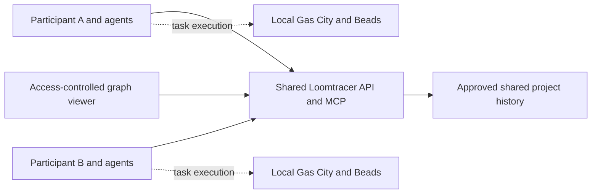

# Shared Loomtracer workspace

A shared workspace lets people retrieve, contribute to, and navigate the same approved
project history. The graph viewer, their agents, and their Gas City workers address the same
information. Sharing repositories or connecting a frontend to an API does not merge histories.

These documents describe the current contracts and acceptance checks. They do not establish
a provisioned shared deployment or an implemented cross-format importer. Keep implementation
tasks and dependencies in Beads; keep actual migration manifests and owner handoffs private.

- [Contribution and handoff guide](contributing.md): independent development and integration boundaries.
- [Synthetic rehearsal](synthetic-rehearsal.md): run the isolated sharing test and read-only migration preview.
- [Migration runbook](migration-runbook.md): complete scoped export, preservation, rehearsal and cutover.
- [New-user onboarding](onboarding.md): joining a provisioned workspace and proving shared visibility.

## Reviewed contracts

The November 4, 2026 review checked Rust master
[`775bb277403237a4055ef8f1b9d741c00de4b89b`][rust-head]. The latest stable release was
[`v0.8.0`][stable], which this frontend pins. Master and the stable release are distinct
contracts; the package version alone does not distinguish them. Recheck the deployed commit
and the release pin before relying on an endpoint or behavior.

| Surface | Existing behavior | Shared-use boundary |
| --- | --- | --- |
| Hosted Entry/Connection service | Source-backed, versioned contributions, grouped relationships, separate server commitment and grant records. | Workspace-wide reads; a project filter is not a permission boundary. |
| Rust API, CLI and MCP | Decision-event ledger, tenant isolation, administrative user and agent-token provisioning. | Confirm deployed authentication mode, shared tenant and actor rules. Projects do not provide separate read permissions. |
| This graph viewer | Reads the Rust API for projects, graph, timeline, search, decisions and relationships. | One backend credential per viewer deployment; no built-in human login. Private hosted use needs an access gate. |
| Each Gas City | Agents, worktrees and Beads/Dolt task execution state. | Configure shared memory separately. Synchronizing task stores is a separate coordination choice. |

## Two distinct milestones

### Bounded shared pilot

An isolated test can use existing administrative provisioning to place two synthetic humans
and their separate agents in one opaque-token tenant. It can prove reciprocal capture/read,
other-tenant exclusion and individual revocation without a production endpoint. This does not
require building organization login, project ACLs or a general capability system first.

A real pilot needs the service owner's endpoint, credentials and explicit agreement on its
identity behavior. WorkOS-enabled Postgres currently provisions tenants per subject and rejects
opaque tokens; the administrative opaque-token route is an alternative mode, not a workaround
for an incompatible deployment. HTTP MCP deliberately permits explicit actor overrides.
Do not issue outside-party access on the assumption that this is credential-bound authorship.

Use a clearly scoped pilot project with one recording route. Existing hosted history and its
authority remain on their current service until migration acceptance. A pilot can demonstrate
shared use; it does not complete historical consolidation or provide a basis for dual-writing
the same contributions indefinitely.

### Complete historical consolidation

Merge only owner-approved project history into a dedicated shared boundary. Preserve excluded
projects, source identities and original snapshots. Both agents and the viewer must retrieve
the preserved contributions, sources, relationships, corrections and relevant authority history.

The Rust repository explicitly defines a decision graph, excludes a general-purpose knowledge
graph/chat archive, and treats humans and agents as first-class actors. The hosted service's
generic Entry/Connection model and owner-granted commitment mechanism are different contracts.
Preserving that source history is a migration requirement; adopting its entire model as the
Rust product is a joint design decision. A preservation contract must explain the mapping
without silently expanding product scope or changing either source's approval semantics.

Rust native replay is not a ReasoningBundle importer. Unsupported required records must appear
in a loss report and block full cutover. An archive alongside a simplified graph is useful
preservation, but alone does not provide common retrieval. Operational audit rows can remain
in a controlled archive; they need not become graph nodes or destination retry state.

## Intended shared topology

Use one owner-confirmed memory service and a dedicated tenant/workspace containing only the
approved shared history. Each human and agent has a distinct identity. Both cities connect
through the API/MCP interfaces.

After a historical cutover, shared contributions have one canonical recording route. Preserve
prior decisions about architecture and authority and record any replacement explicitly. Import
must neither manufacture new approvals nor silently demote existing authoritative guidance.

## Required owner inputs for live use

- Exact API/MCP addresses, running version/commit, tenant/project identifiers and service owner.
- Supported authentication mode, separate human/agent identities, actor attribution rules,
  actual enforced permissions, viewer access and individual revocation.
- Selected source records, dependency closure, exclusions and supported export mechanism.
- Agreed preservation and trust-continuity contract, tested backup/recovery and cutover owner.

The endpoint, authentication, identities and access rules gate a live pilot. Source selection,
preservation, recovery and cutover agreement additionally gate historical consolidation. Local
export tooling, synthetic preservation fixtures, shared-tenant tests and navigation against
released endpoints can proceed independently.
Backend API changes must land and release before this frontend raises `LOOMTRACER_VERSION`.

## Contract sources

- [Viewer API contract](../../web/LOOMTRACER_API_MAP.md) and [release order](../../CONTRIBUTING.md).
- [Rust scope and actor principles][rust-agents], [shared provisioning][provisioning],
  [authentication selection][auth], [tenant permissions][tenancy], and
  [intentional MCP actor override test][actor-test].
- [Native replay][replay] and [Rust graph contract][graph-contract].
- [Hosted source types][hosted-types], [workspace access and stored response][hosted-storage].
  Hosted source links identify the inspected source revision; they do not establish the
  running deployment SHA.

[rust-head]: https://github.com/alexknips/loomtracer/commit/775bb277403237a4055ef8f1b9d741c00de4b89b
[stable]: https://github.com/alexknips/loomtracer/releases/tag/v0.8.0
[rust-agents]: https://github.com/alexknips/loomtracer/blob/775bb277403237a4055ef8f1b9d741c00de4b89b/AGENTS.md#L55-L78
[provisioning]: https://github.com/alexknips/loomtracer/blob/775bb277403237a4055ef8f1b9d741c00de4b89b/src/ledger/postgres/tenant_store.rs#L314-L397
[auth]: https://github.com/alexknips/loomtracer/blob/775bb277403237a4055ef8f1b9d741c00de4b89b/src/api/auth.rs#L154-L183
[tenancy]: https://github.com/alexknips/loomtracer/blob/775bb277403237a4055ef8f1b9d741c00de4b89b/docs/MULTI_TENANCY.md#L364-L404
[actor-test]: https://github.com/alexknips/loomtracer/blob/775bb277403237a4055ef8f1b9d741c00de4b89b/tests/api.rs#L6474-L6493
[replay]: https://github.com/alexknips/loomtracer/blob/775bb277403237a4055ef8f1b9d741c00de4b89b/src/replay.rs
[graph-contract]: https://github.com/alexknips/loomtracer/blob/775bb277403237a4055ef8f1b9d741c00de4b89b/docs/GRAPH_CONTRACT.md
[hosted-types]: https://github.com/TheChairmanMiao/neurofilament/blob/5c0a0278c6a6a094caa24329153c43f81700984f/packages/reasoning/src/types.ts
[hosted-storage]: https://github.com/TheChairmanMiao/neurofilament/blob/5c0a0278c6a6a094caa24329153c43f81700984f/supabase/migrations/20261012000000_reasoning_architecture.sql
